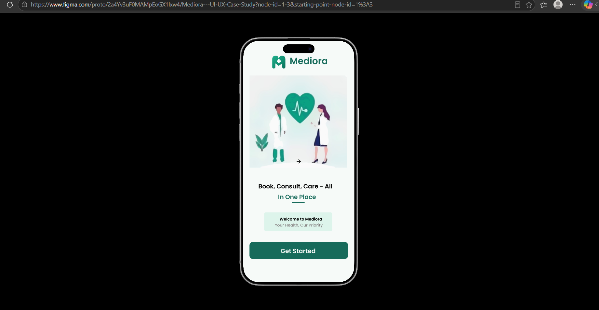
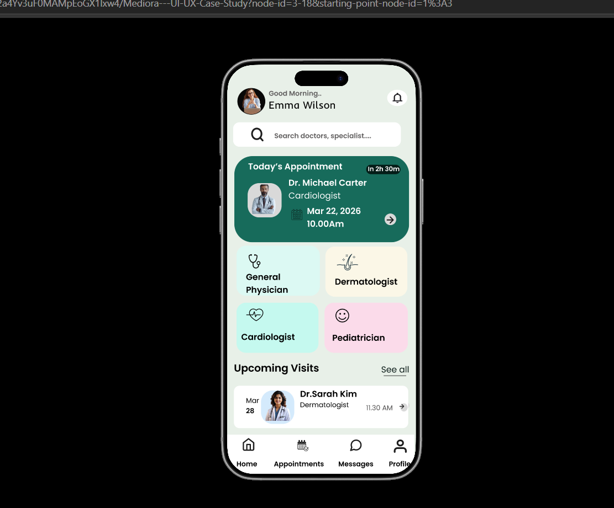
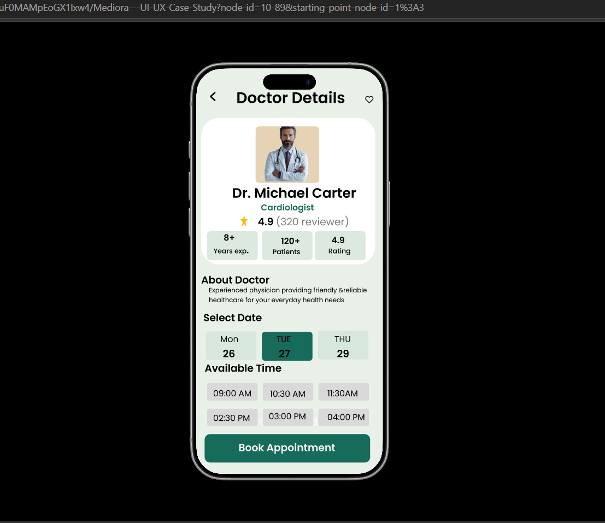
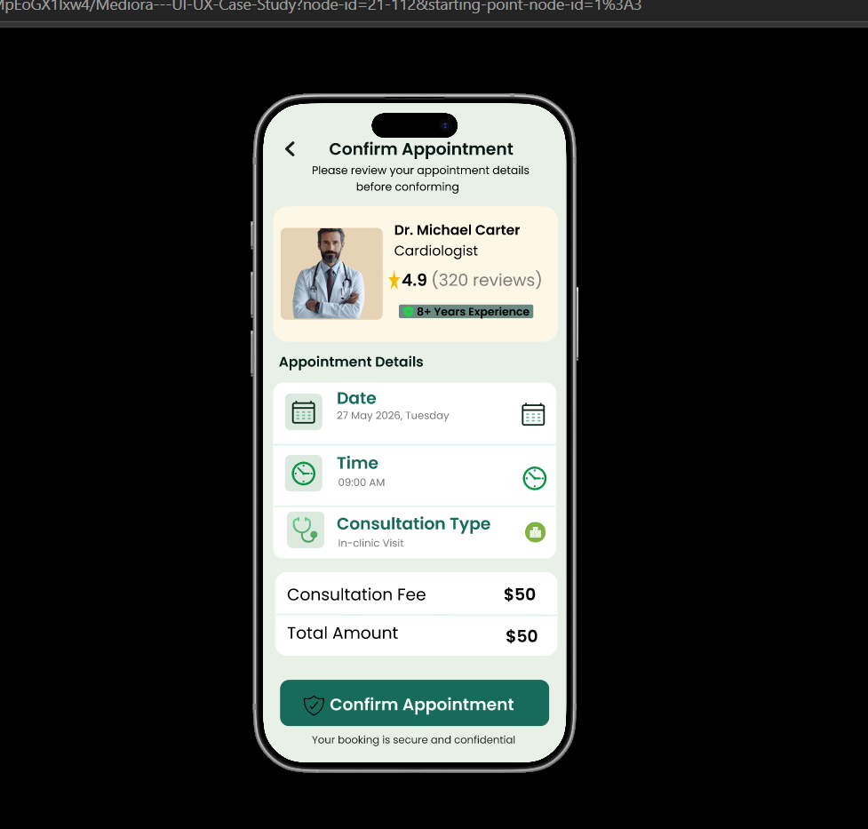
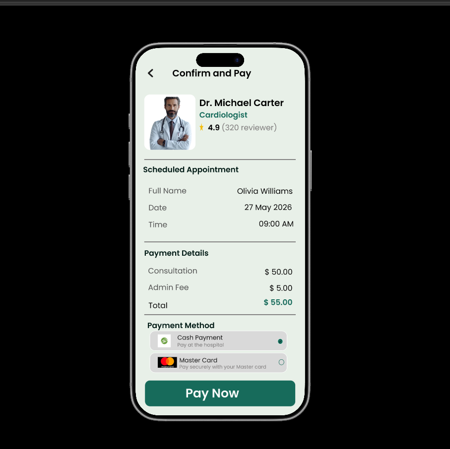
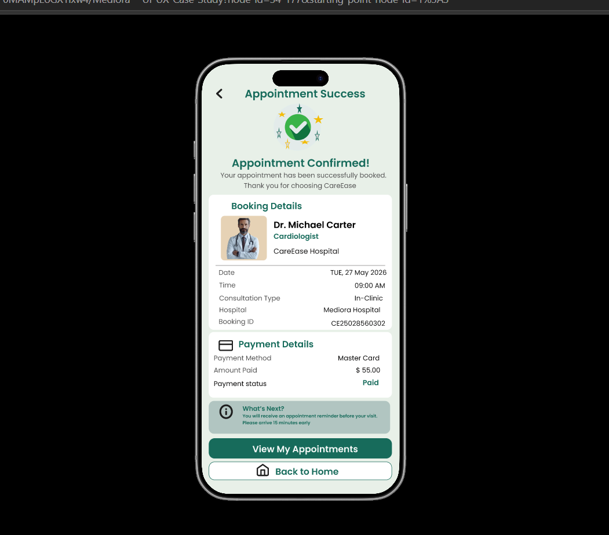
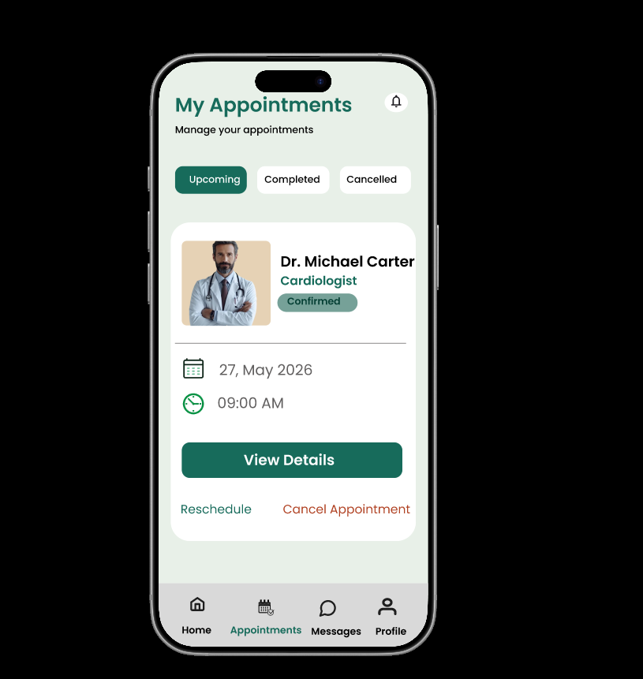

Mediora – Healthcare Appointment Booking App UI/UX Design

Project Overview
Mediora is a healthcare appointment booking mobile app UI/UX design project created using Figma. The main goal of this project is to provide users with a simple and user-friendly experience for finding doctors and booking medical appointments.

Project Features
- User Login
- Home Page with doctor information
- Doctor Details
- Appointment Confirmation
- Payment Details
- Appointment Success
- My Appointments

Tools Used
- Figma

Design Screenshots
The screenshots folder contains the main screens designed for the Mediora application.

Project Type
Personal UI/UX Design Project

Prototype Link
"View Mediora Figma Prototype" (https://www.figma.com/proto/2a4Yv3uF0MAMpEoGX1Ixw4/Mediora---UI-UX-Case-Study?node-id=1-3&p=f&t=qLkNh0r10S4fdFgG-1&scaling=scale-down&content-scaling=fixed&page-id=0%3A1&starting-point-node-id=1%3A3)
